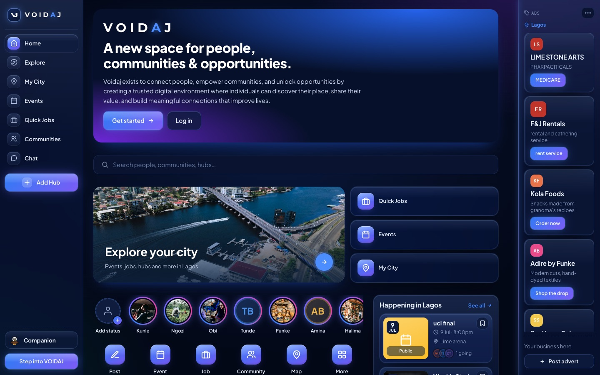

# VOIDAJ

A community platform where an **AI companion introduces you to people, communities and discussions** instead of feeding you an endless scroll. Built solo as the founding engineer for an early-stage startup; in testing with beta users.

**Live:** https://voidaj.com



## What it does

- **Communities and discussions:** join communities, post, and reply in threaded comments ranked by up/down votes.
- **AI companion:** ask "Introduce me to people in sustainable agriculture" and it recommends real communities, people and posts, each with a reason. (Switched off in the app for now; the API and its tests remain. See `src/features.js`.)
- **Business on VOIDAJ:** business pages with listings (properties, services, products, offers), followers, reviews, enquiries through Chat, and promoted listings.
- **Events, quick jobs and chat** between members.
- **Moderation:** members report posts; owners, admins and moderators review a queue and remove or dismiss, with a moderation log.

## Engineering highlights

- **The AI can't make things up.** Claude picks from a catalog of live database records, and every ID it returns is checked against the database before it's shown. If the API key is missing or the call fails, a rule-based matcher takes over, so the feature never breaks.
- **Serverless on Postgres.** The API runs as one Vercel serverless function. Data moved from SQLite to managed Postgres, because serverless functions have no disk that lasts between requests.
- **Auth and roles:** bcrypt-hashed passwords, Sign in with Google and Apple (OAuth code flow with state checks), JWT sessions in httpOnly cookies, "sign out other devices", and community roles (owner > admin > moderator > member).
- **Tests** run on every push in GitHub Actions. Integration tests drive the real Express app against a real Postgres: auth, privacy and messaging rules, membership, moderation permissions, jobs, business pages, and the AI companion's grounding and fallback (with the Claude SDK mocked). Unit tests cover the server's helpers, and React Testing Library covers the API client and components.

## Tech

React 18, Vite, Node.js, Express, PostgreSQL, Claude API, Vitest + Supertest, GitHub Actions, Vercel.

## Run it locally

Needs Node 20+ and Postgres:

```bash
npm install
createdb voidaj
cp .env.example .env    # set DATABASE_URL=postgres://<you>@127.0.0.1:5432/voidaj
npm run dev             # API on :8787, web app on http://localhost:5173
```

The first request creates the tables and seeds sample data. Add `ANTHROPIC_API_KEY` to `.env` to use the real AI companion; without it, the rule-based fallback runs.

**Tests:**

```bash
createdb voidaj_test   # once
npm test               # everything
npm run test:api       # server only (needs the database)
npm run test:web       # React only (no database)
npm run test:coverage  # with a coverage report in coverage/
```

The server tests wipe their database, so they refuse to run unless it's local and named `*_test`. CI (`.github/workflows/test.yml`) runs the suite with coverage and the production build on every push; it fails if a test fails or server line coverage drops below 80%.

## Monitoring

- **Health endpoint:** `GET /api/health` runs `SELECT 1` against Postgres with a 3-second timeout (`HEALTH_DB_TIMEOUT_MS`). It answers `200` with `"status": "ok"`, the database latency, the app version and the deployed commit, or `503` if the database is unreachable or too slow. The response never includes connection details or driver errors; those go to the server log.
- **Uptime check and alerts:** `.github/workflows/uptime.yml` calls the health endpoint every 15 minutes. A run fails if the answer isn't a `200` with `"status": "ok"` within 5 seconds (`HEALTH_MAX_SECONDS`), twice in a row 30 seconds apart. GitHub emails a failed run to whoever last changed the workflow's schedule (as long as Actions email notifications are on in their GitHub settings). It needs the repository variable `HEALTH_URL` (Settings → Secrets and variables → Actions → Variables), for example `https://voidaj.com/api/health`. GitHub may start scheduled runs a few minutes late and pauses them after 60 days with no commits.
- **Error logs:** every 5xx response writes one line of JSON (`"event": "request_failed"`) with the method, route, status, duration, request id and, for a crash, the error and stack. Search for `request_failed` or a request id in the Vercel dashboard's Logs. Every response carries an `X-Request-Id` header; on Vercel it matches Vercel's own request id. Query strings are never logged.

Run the check by hand:

```bash
curl -i https://voidaj.com/api/health
gh workflow run uptime.yml   # or Actions tab → Uptime → Run workflow
```

## Where to look in the code

| File | What it does |
|---|---|
| `server/index.js` | API routes |
| `server/db.js` | Postgres schema and queries |
| `server/companion.js` | AI companion: grounding and fallback |
| `server/auth.js` | Sessions and passwords |
| `server/monitoring.js` | Health check, request ids, JSON error logs |
| `server/social.js` | Sign in with Google and Apple |
| `server/business.js` | Business pages, listings and promotions |
| `test/` | Server integration tests (`test/unit/` for helpers) |
| `src/**/*.test.js(x)` | React tests |
